# CafeCampus-ia


## Descripción

Aplicación de práctica para pedidos de la cafetería del campus. El estudiante consulta productos, arma su carrito, confirma y sigue sus pedidos. El administrador atiende pedidos, gestiona productos y cambia las preferencias. Ambos perfiles comparten una única base Room local.

Base de la Fase 1 más las mejoras de la **Fase 2**, en la rama `mejora-ia` y carpeta `Semana08/CafeCampus-ia`. Kotlin, Jetpack Compose, Material 3, Room, DataStore y Navigation Compose. La rama `main` conserva la Fase 1 en `Semana08/CafeCampus`.

### Mejoras con IA

- **Búsqueda:** texto y categorías combinados con Solo disponibles, múltiples palabras, tildes/mayúsculas normalizadas y limpieza de filtros. La base ya tenía búsqueda funcional; este commit la amplía.
- **Repetir pedido:** botón en Historial, confirmación si hay una bolsa existente, catálogo y precios actuales, avisos de productos omitidos y revisión antes de confirmar.
- **Gráfico real:** consulta Room por hora local y día, Flow hasta la pantalla, 24 horas, sin cancelados y con actualización al cambiar de día. El gráfico ya no contiene la serie fija de ejemplo.
- **Fotos adicionales:** el administrador puede elegir una foto de galería y guardarla en el producto. Se muestra en ambos menús, detalle y bolsa; conserva la ilustración si no hay foto.

[PROMPTS.md](PROMPTS.md) documenta la herramienta real utilizada, instrucciones, correcciones, arquitectura y límites de validación.

La implementación utiliza Room **2.7.2** (runtime, ktx y compiler), actualizado desde 2.6.1 para resolver el error de KSP observado con la configuración del proyecto. Se conservaron las versiones de AGP, Kotlin y KSP.

## Cuentas ficticias

| Perfil | Correo | Clave |
| --- | --- | --- |
| Estudiante | juan@campus.test | 1234 |
| Administrador | admin@cafe.test | admin |

Los datos se siembran una sola vez, en una transacción, cuando no hay usuarios. El inicio de sesión espera que termine esa inicialización. Al abrir una nueva ejecución se solicita correo, contraseña y perfil. «Cambiar de perfil» cierra la sesión actual, selecciona el otro perfil en el login y vuelve a solicitar credenciales. El tema oscuro y la recepción de pedidos siguen persistiendo en DataStore. La rotación conserva la sesión del ViewModel; no se exige iniciar sesión otra vez por rotar.

Estas dos decisiones —pedir credenciales al reabrir/cambiar de perfil y habilitar la búsqueda— son ajustes solicitados durante la práctica y difieren del flujo inicial del PDF. El interruptor Notificaciones guarda una preferencia local; no implementa avisos del sistema Android.

## Estructura de paquetes

```text
com.tecsup.cafecampus
├── data
│   ├── local
│   │   ├── dao
│   │   │   ├── PedidoDao.kt
│   │   │   ├── ProductoDao.kt
│   │   │   └── UsuarioDao.kt
│   │   ├── entity
│   │   │   ├── DetallePedido.kt
│   │   │   ├── Pedido.kt
│   │   │   ├── Producto.kt
│   │   │   └── Usuario.kt
│   │   ├── relation
│   │   │   └── PedidoConDetalle.kt
│   │   ├── AlmacenFotos.kt
│   │   ├── CafeDatabase.kt
│   │   └── DatosIniciales.kt
│   ├── prefs
│   │   └── PreferenciasStore.kt
│   └── repository
│       ├── CafeRepository.kt
│       └── CafeRepositoryRoom.kt
├── model
│   ├── EstadoPedido.kt
│   ├── ItemCarrito.kt
│   ├── PedidosPorHora.kt
│   ├── ResultadoRepeticion.kt
│   └── Rol.kt
├── ui
│   ├── admin
│   │   ├── AjustesScreen.kt
│   │   ├── ComponentesAdmin.kt
│   │   ├── DetallePedidoAdminScreen.kt
│   │   ├── FormularioProductoScreen.kt
│   │   ├── MenuAdminScreen.kt
│   │   ├── PanelScreen.kt
│   │   └── PedidosAdminScreen.kt
│   ├── cliente
│   │   ├── ComponentesEstudiante.kt
│   │   ├── ConfirmarPedidoScreen.kt
│   │   ├── DetalleProductoScreen.kt
│   │   ├── LoginScreen.kt
│   │   ├── MenuScreen.kt
│   │   ├── MisPedidosScreen.kt
│   │   ├── SeguimientoScreen.kt
│   │   └── SplashScreen.kt
│   ├── components
│   │   ├── AppTopBar.kt
│   │   ├── CafeButton.kt
│   │   ├── CafeTextField.kt
│   │   ├── EstadoChip.kt
│   │   ├── ImagenProducto.kt
│   │   ├── PedidoCard.kt
│   │   ├── ProductoCard.kt
│   │   ├── ProductoIcono.kt
│   │   └── StepperEstado.kt
│   ├── navigation
│   │   ├── NavCafe.kt
│   │   └── Rutas.kt
│   └── theme
│       ├── CafeTheme.kt
│       ├── Color.kt
│       ├── IlustracionTheme.kt
│       ├── Theme.kt
│       └── Type.kt
├── viewmodel
│   ├── CafeViewModelFactory.kt
│   ├── MenuAdminViewModel.kt
│   ├── MenuViewModel.kt
│   ├── PanelAdminViewModel.kt
│   ├── PedidosAdminViewModel.kt
│   ├── PedidosClienteViewModel.kt
│   └── SesionViewModel.kt
├── CafeApp.kt
└── MainActivity.kt
```

## Arquitectura MVVM

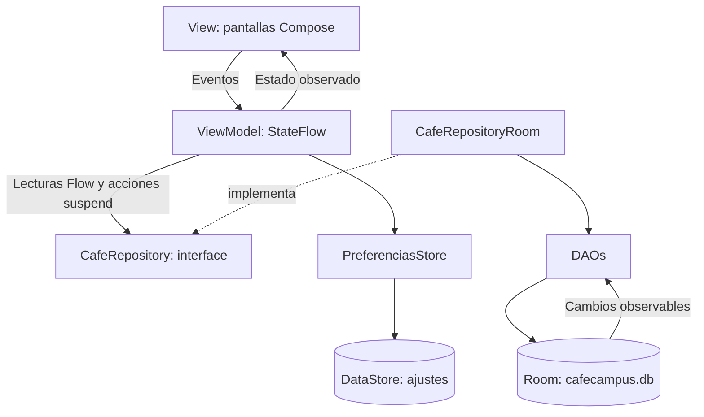

Las pantallas reciben ViewModels. La creación de dependencias se resuelve en CafeApp/CafeViewModelFactory y se conecta en NavCafe. Los ViewModels de negocio dependen de CafeRepository; sesión y confirmación también consultan PreferenciasStore, como exige el contrato de DataStore del laboratorio.

Lecturas reactivas: Flow transformado a StateFlow con stateIn. Escrituras: suspend y viewModelScope. PedidoDao.crearPedido usa @Transaction; los detalles guardan una foto del nombre y precio, sin clave foránea al producto. Las transiciones viven en EstadoPedido y PedidosAdminViewModel. El carrito se mantiene en el ViewModel durante una rotación; no se persiste ante la muerte del proceso.

El tema CafeTheme aplica el perfil y el modo oscuro; los colores fijos están centralizados en el tema, incluidos los colores semánticos de estado. Las pantallas consumen MaterialTheme.colorScheme y los colores semánticos provistos por el tema. El tema de plantilla original se conserva para GreetingPreview.

## Capturas de la aplicación

Capturas reales de la **Fase 1** proporcionadas por la usuaria, en modo oscuro. Las capturas de las nuevas mejoras de la Fase 2 quedan pendientes tras ejecutarla en Android. Se incluyen las seis vistas principales solicitadas y cinco vistas adicionales; los archivos originales no fueron retocados.

### Estudiante

| Menú | Confirmación: bolsa vacía | Seguimiento |
| --- | --- | --- |
| 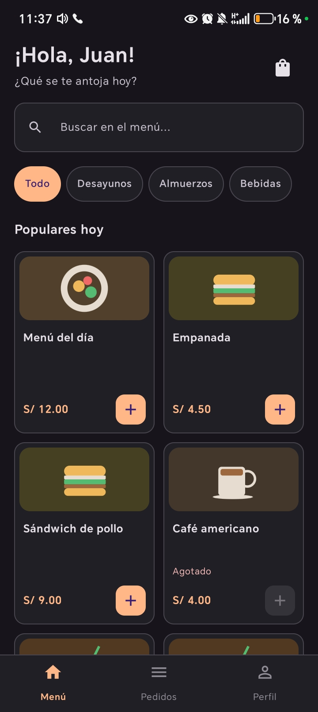 | 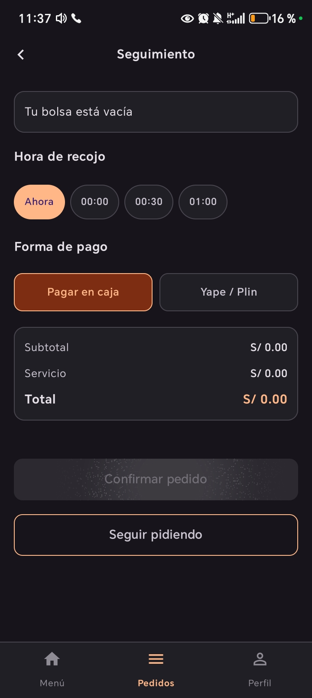 | 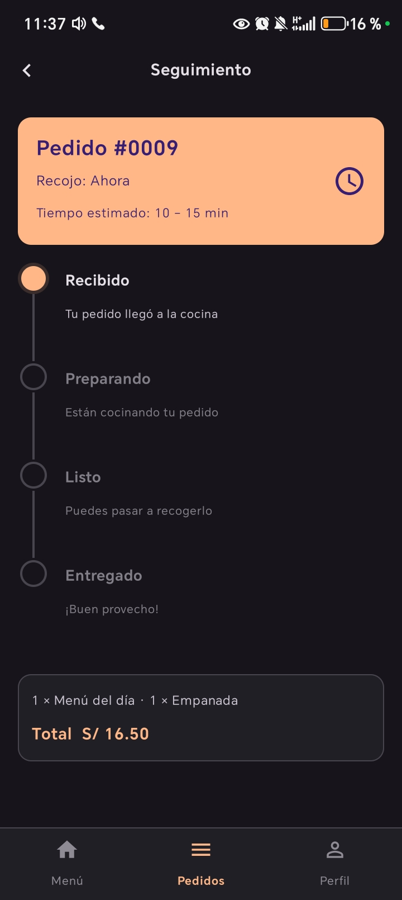 |

La captura central muestra el formulario sin productos, total S/ 0.00 y confirmación deshabilitada. En esa imagen el título visible dice «Seguimiento», aunque el contenido corresponde al formulario de confirmación; se conserva la evidencia original sin corregirla gráficamente. Para demostrar el resumen antes del envío, queda pendiente una captura de este formulario con productos en la bolsa.

### Administrador

| Panel | Pedidos | Gestión del menú |
| --- | --- | --- |
| 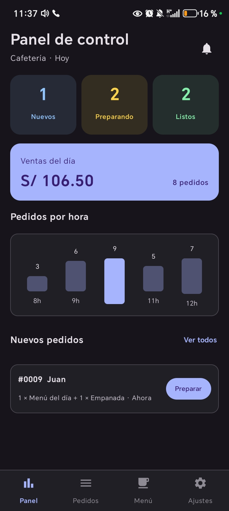 | 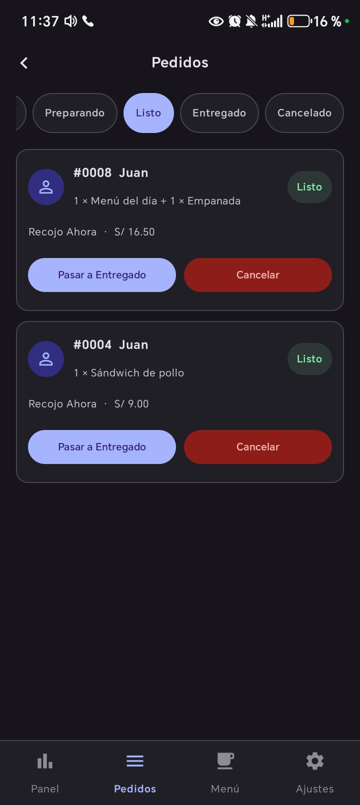 | 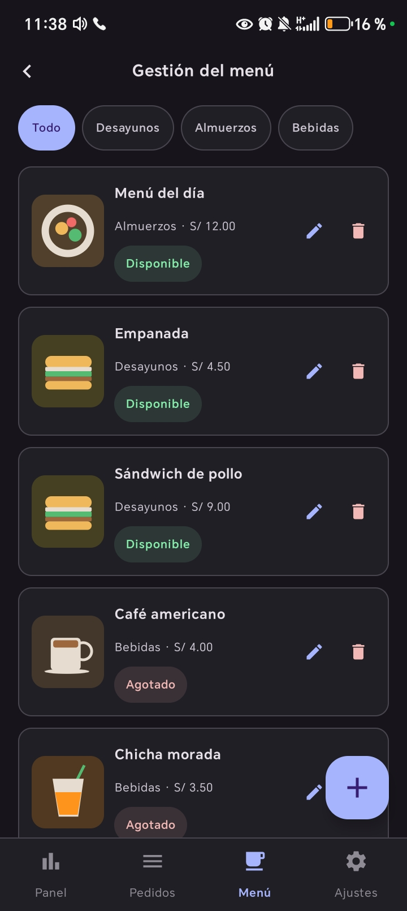 |

### Vistas adicionales

| Login | Mis pedidos | Perfil |
| --- | --- | --- |
| 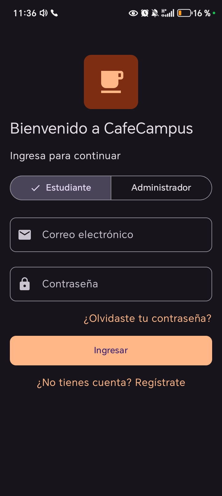 | 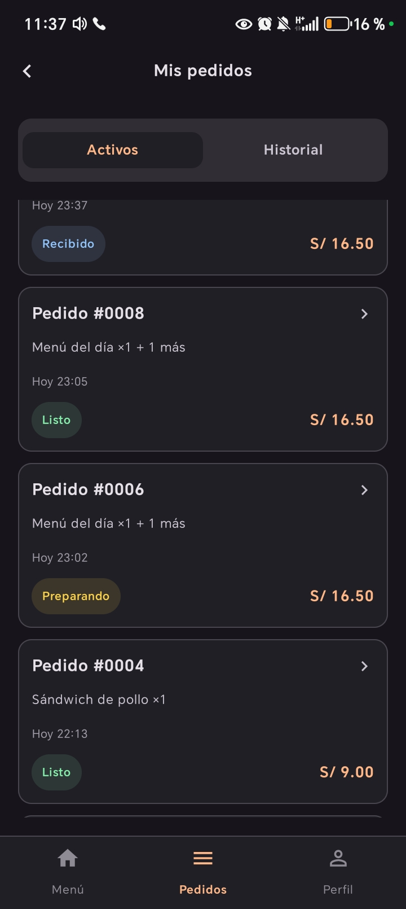 | 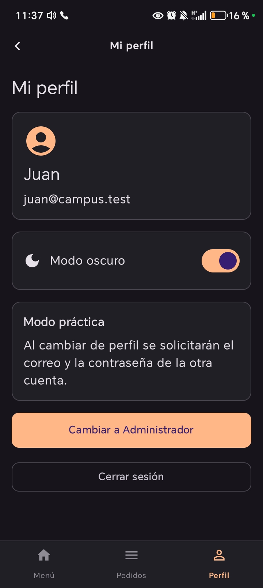 |

| Editar producto | Ajustes |
| --- | --- |
| 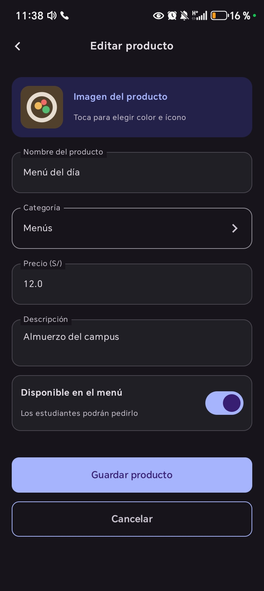 | 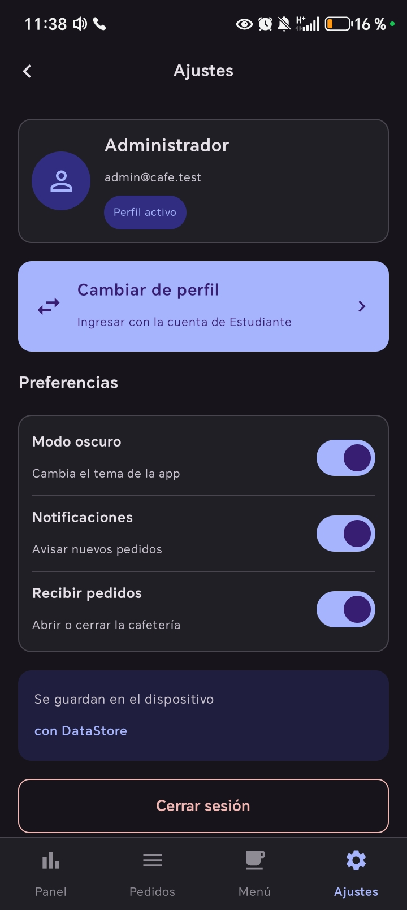 |

[Índice y alcance de las capturas](docs/capturas/README.md) · [Pruebas y evidencias](docs/PRUEBAS_ACEPTACION.md)

## Paso 12: pruebas de aceptación

La usuaria proporcionó once capturas reales. Estas confirman visualmente la ejecución de pantallas de ambos perfiles y aportan evidencia parcial de algunas pruebas. El asistente no ejecutó Gradle ni las secuencias completas de prueba; por eso se distingue «evidencia parcial» de una prueba aprobada.

La guía enlazada indica pasos, resultados esperados y evidencias para completar cada prueba sin borrar los datos del dispositivo.

| Prueba | Resultado esperado | Estado |
| --- | --- | --- |
| Login con clave incorrecta | Mensaje de error; no permite entrar. | Pendiente en emulador |
| Estudiante agrega 2 productos y confirma | Pedido RECIBIDO, total correcto y carrito vacío. | Parcial: #0009 Recibido, Menú S/ 12.00 + Empanada S/ 4.50 = S/ 16.50; no se ve la secuencia de envío/vaciado. |
| Producto agotado | No permite agregarlo ni confirmar un carrito que lo contiene. | Parcial: Café americano Agotado y botón + deshabilitado en el menú; falta probar confirmación. |
| Administrador pasa un pedido a Preparando | Seguimiento cambia por Flow sin reiniciar. | Parcial: se ven estados Preparando/Listo y el #0008 Listo en ambos perfiles; no se observa la transición en vivo. |
| Administrador cancela un pedido | Aparece CANCELADO en el historial del estudiante. | Pendiente en emulador |
| Administrador cambia el precio de un producto | Los pedidos anteriores conservan nombre y precio unitario. | Pendiente en emulador |
| Ventas del día | Suma pedidos del día no cancelados. | Parcial: panel S/ 106.50 y 8 pedidos; falta contrastar cancelados y suma. |
| Cerrar y abrir la aplicación | Persisten pedidos y modo oscuro; se vuelve a solicitar login, según el ajuste pedido por el usuario. | Parcial: modo oscuro visible; reinicio y persistencia no demostrados. |
| Rotar la pantalla | Conserva carrito, sesión y datos de pantalla. | Pendiente en emulador |

Comprobaciones adicionales: selector de rol y error de rol incorrecto; CRUD de productos y confirmación de eliminación; cerrar cafetería y bloquear confirmación; persistencia de modo oscuro; cambio de perfil y limpieza de pila. Pendientes de ejecución.

## Revisión realizada

Se revisaron paquetes, imports internos, contratos de interface/implementación, parámetros, delimitadores, rutas y límites entre capas en los 59 archivos Kotlin. Las 14 consultas SQL se validaron con SQLite sobre un esquema equivalente; la suma vacía devuelve 0.0. No se ejecutaron KSP, Room ni el compilador Kotlin. Las capturas aportadas muestran la interfaz ejecutándose en un dispositivo; no reemplazan las pruebas completas de aceptación ni confirman por sí solas qué revisión se compiló.

Se conservaron los modelos originales, Producto y ProductoDao. La actualización de dependencias realizada durante la Fase 1 fue Room a 2.7.2. En la Fase 2 no se cambiaron versiones ni archivos de configuración Gradle. El esquema Room pasa de 1 a 2 con migración aditiva de fotoUri, sin migración destructiva. Los cambios se organizaron en commits locales de los pasos del laboratorio y un commit adicional de compatibilidad. La revisión de Git consultó `origin/main` sin hacer push. No se generaron APK ni archivos zip desde el asistente.

## Ejecutar y validar

1. Abrir `Semana08/CafeCampus-ia` en Android Studio y sincronizar con la configuración existente.
2. Elegir el emulador y ejecutar con Run. La compilación y ejecución se realizan desde Android Studio.
3. Ingresar con la cuenta ficticia del perfil correspondiente.
4. Completar [las nueve pruebas](docs/PRUEBAS_ACEPTACION.md) y registrar los resultados; complementar las capturas con la confirmación que contenga productos.
5. Las once imágenes recibidas ya están incorporadas. Cambiar los estados pendientes únicamente al comprobar cada prueba completa.

## Estado de la entrega

El código, la documentación y once capturas reales están incorporados. Falta una captura de confirmación con productos y completar las pruebas de aceptación que solo tienen evidencia parcial o siguen pendientes. No se presenta la práctica como completamente verificada mientras falten esas comprobaciones.

## Usar las mejoras de la Fase 2

1. **Buscar:** en el menú del estudiante escribir `cafe`, `americano cafe` o parte del nombre. Cambiar categoría y Solo disponibles; Limpiar búsqueda y filtros restaura Todo.
2. **Repetir:** en Mis pedidos → Historial pulsar Repetir pedido. Confirmar el reemplazo si la bolsa no está vacía. Revisar avisos y total actualizado en Confirmar pedido; elegir hora/pago y confirmar expresamente.
3. **Gráfico:** como administrador, crear/avanzar/cancelar pedidos y observar las barras del día actual. Deslizar horizontalmente para consultar las 24 horas.
4. **Fotos:** Administrador → Menú → editar o agregar producto → tocar Imagen del producto → seleccionar una foto en el selector del teléfono → esperar la vista previa → Guardar producto. Quitar foto/Usar ilustración restaura el dibujo.

Las fotos se copian al espacio privado de la app: no requieren conexión, permisos amplios ni enlaces externos. Se aceptan imágenes decodificables de hasta 20 MB y se reducen antes de almacenarlas. No se incluyen fotos nuevas en los productos existentes hasta que el administrador las seleccione. Las fotos elegidas en el teléfono no se suben a GitHub. La app conserva el mismo applicationId y migra su base a versión 2: esta base actualizada no es compatible con la versión 1 del código de main; volver a instalar la Fase 1 requiere planificar los datos de ese dispositivo.

### Validación pendiente en Android

No se ejecutó Gradle ni se compiló esta Fase 2. Verificar en Android Studio búsqueda, repetición con agotados/eliminados, confirmación de reemplazo, actualización del gráfico y su día local, selección/cancelación de fotos, persistencia tras reiniciar y migración conservando los pedidos. También comprobar la carga de fotos en productos editados y su visualización desde el estudiante.

[Plan de pruebas de Fase 2](docs/PRUEBAS_FASE2.md). Los resultados de SQL y revisión estática se documentan en PROMPTS.md; no se presentan como pruebas Android aprobadas.

## Para pensar

1. Repository es una interface para que el ViewModel use un contrato y pueda cambiar la fuente de datos sin cambiar la pantalla.
2. crearPedido es suspend porque realiza una acción; observarPedidosCliente es Flow porque avisa cada vez que cambian los pedidos.
3. Con bases distintas, el administrador y el estudiante verían pedidos diferentes y el seguimiento no reflejaría los cambios.
4. Con un servidor, se implementaría el mismo contrato con una fuente remota y se resolverían red, autenticación y errores en la capa de datos.
