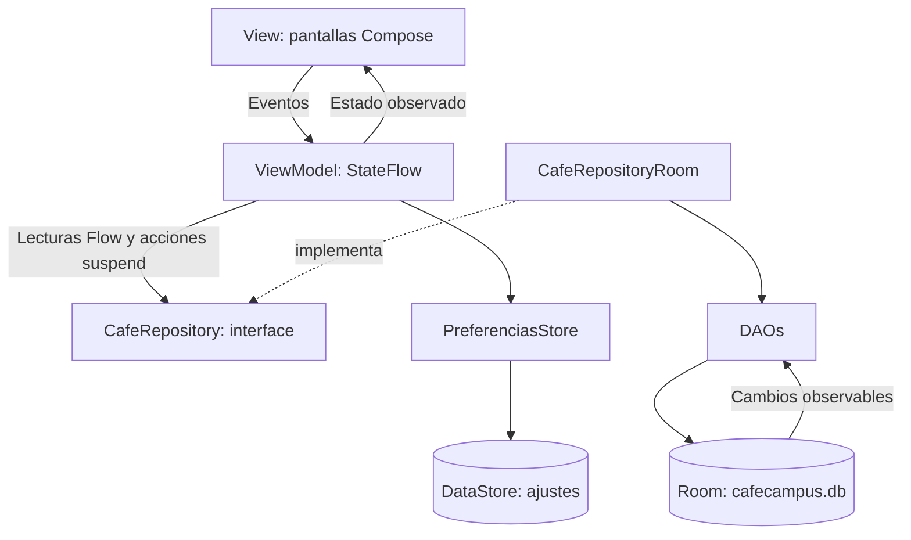

# CafeCampus


## Descripción

Aplicación de práctica para pedidos de la cafetería del campus. El estudiante consulta productos, arma su carrito, confirma y sigue sus pedidos. El administrador atiende pedidos, gestiona productos y cambia las preferencias. Ambos perfiles comparten una única base Room local.

Implementación de la Fase 1 (pasos 1 al 12), Kotlin, Jetpack Compose, Material 3, Room, DataStore y Navigation Compose. No incluye las mejoras de la Fase 2. La búsqueda visual del menú y el gráfico de ejemplo del panel no utilizan datos dinámicos.

## Cuentas ficticias

| Perfil | Correo | Clave |
| --- | --- | --- |
| Estudiante | juan@campus.test | 1234 |
| Administrador | admin@cafe.test | admin |

Los datos se siembran una sola vez, en una transacción, cuando no hay usuarios. El inicio de sesión espera que termine esa inicialización. En modo práctica se puede cambiar de perfil desde Perfil/Ajustes sin volver a introducir credenciales.

## Estructura de paquetes

```text
com.tecsup.cafecampus
├── data
│   ├── local
│   │   ├── dao
│   │   │   ├── PedidoDao.kt
│   │   │   ├── ProductoDao.kt
│   │   │   └── UsuarioDao.kt
│   │   ├── entity
│   │   │   ├── DetallePedido.kt
│   │   │   ├── Pedido.kt
│   │   │   ├── Producto.kt
│   │   │   └── Usuario.kt
│   │   ├── relation
│   │   │   └── PedidoConDetalle.kt
│   │   ├── CafeDatabase.kt
│   │   └── DatosIniciales.kt
│   ├── prefs
│   │   └── PreferenciasStore.kt
│   └── repository
│       ├── CafeRepository.kt
│       └── CafeRepositoryRoom.kt
├── model
│   ├── EstadoPedido.kt
│   ├── ItemCarrito.kt
│   └── Rol.kt
├── ui
│   ├── admin
│   │   ├── AjustesScreen.kt
│   │   ├── DetallePedidoAdminScreen.kt
│   │   ├── FormularioProductoScreen.kt
│   │   ├── MenuAdminScreen.kt
│   │   ├── PanelScreen.kt
│   │   └── PedidosAdminScreen.kt
│   ├── cliente
│   │   ├── ConfirmarPedidoScreen.kt
│   │   ├── DetalleProductoScreen.kt
│   │   ├── LoginScreen.kt
│   │   ├── MenuScreen.kt
│   │   ├── MisPedidosScreen.kt
│   │   ├── SeguimientoScreen.kt
│   │   └── SplashScreen.kt
│   ├── components
│   │   ├── AppTopBar.kt
│   │   ├── CafeButton.kt
│   │   ├── CafeTextField.kt
│   │   ├── EstadoChip.kt
│   │   ├── PedidoCard.kt
│   │   ├── ProductoCard.kt
│   │   ├── ProductoIcono.kt
│   │   └── StepperEstado.kt
│   ├── navigation
│   │   ├── NavCafe.kt
│   │   └── Rutas.kt
│   └── theme
│       ├── CafeTheme.kt
│       ├── Color.kt
│       ├── Theme.kt
│       └── Type.kt
├── viewmodel
│   ├── CafeViewModelFactory.kt
│   ├── MenuAdminViewModel.kt
│   ├── MenuViewModel.kt
│   ├── PanelAdminViewModel.kt
│   ├── PedidosAdminViewModel.kt
│   ├── PedidosClienteViewModel.kt
│   └── SesionViewModel.kt
├── CafeApp.kt
└── MainActivity.kt
```

## Arquitectura MVVM



Las pantallas reciben ViewModels. La creación de dependencias se resuelve en CafeApp/CafeViewModelFactory y se conecta en NavCafe. Los ViewModels de negocio dependen de CafeRepository; sesión y confirmación también consultan PreferenciasStore, como exige el contrato de DataStore del laboratorio.

Lecturas reactivas: Flow transformado a StateFlow con stateIn. Escrituras: suspend y viewModelScope. PedidoDao.crearPedido usa @Transaction; los detalles guardan una foto del nombre y precio, sin clave foránea al producto. Las transiciones viven en EstadoPedido y PedidosAdminViewModel. El carrito se mantiene en el ViewModel durante una rotación; no se persiste ante la muerte del proceso.

El tema CafeTheme aplica el perfil y el modo oscuro; los colores fijos están centralizados en el tema, incluidos los colores semánticos de estado. Las pantallas consumen MaterialTheme.colorScheme y los colores semánticos provistos por el tema. El tema de plantilla original se conserva para GreetingPreview.

## Capturas pendientes

El usuario agregará las seis capturas tomadas desde Android Studio/emulador:

- [ ] Cliente: menú.
- [ ] Cliente: confirmar pedido.
- [ ] Cliente: seguimiento.
- [ ] Administrador: panel.
- [ ] Administrador: pedidos.
- [ ] Administrador: gestión del menú o ajustes.

## Paso 12: pruebas de aceptación

No se ejecutó Gradle ni se compiló o abrió la aplicación. Todas las pruebas del emulador quedan pendientes; una revisión del código no equivale a haberlas aprobado.

| Prueba | Resultado esperado | Estado |
| --- | --- | --- |
| Login con clave incorrecta | Mensaje de error; no permite entrar. | Pendiente en emulador |
| Estudiante agrega 2 productos y confirma | Pedido RECIBIDO, total correcto y carrito vacío. | Pendiente en emulador |
| Producto agotado | No permite agregarlo ni confirmar un carrito que lo contiene. | Pendiente en emulador |
| Administrador pasa un pedido a Preparando | Seguimiento cambia por Flow sin reiniciar. | Pendiente en emulador |
| Administrador cancela un pedido | Aparece CANCELADO en el historial del estudiante. | Pendiente en emulador |
| Administrador cambia el precio de un producto | Los pedidos anteriores conservan nombre y precio unitario. | Pendiente en emulador |
| Ventas del día | Suma pedidos del día no cancelados. | Pendiente en emulador |
| Cerrar y abrir la aplicación | Persisten pedidos, perfil y modo oscuro. | Pendiente en emulador |
| Rotar la pantalla | Conserva carrito, sesión y datos de pantalla. | Pendiente en emulador |

Comprobaciones adicionales: selector de rol y error de rol incorrecto; CRUD de productos y confirmación de eliminación; cerrar cafetería y bloquear confirmación; persistencia de modo oscuro; cambio de perfil y limpieza de pila. Pendientes de ejecución.

## Revisión realizada

Se revisaron paquetes, imports internos, contratos de interface/implementación, parámetros, delimitadores, rutas y límites entre capas en los 52 archivos Kotlin. Las 13 consultas SQL se validaron con SQLite sobre un esquema equivalente; la suma vacía devuelve 0.0. No se ejecutaron KSP, Room ni el compilador Kotlin. El aspecto final en dispositivo, las llamadas a APIs de Compose y la integración de navegación requieren la compilación y ejecución del proyecto en Android Studio.

No se alteraron configuración Gradle, versiones, modelos originales, Producto o ProductoDao. No se ejecutaron operaciones Git ni se generaron APK o archivos zip durante esta implementación.

## Para pensar

1. Repository es una interface para que el ViewModel use un contrato y pueda cambiar la fuente de datos sin cambiar la pantalla.
2. crearPedido es suspend porque realiza una acción; observarPedidosCliente es Flow porque avisa cada vez que cambian los pedidos.
3. Con bases distintas, el administrador y el estudiante verían pedidos diferentes y el seguimiento no reflejaría los cambios.
4. Con un servidor, se implementaría el mismo contrato con una fuente remota y se resolverían red, autenticación y errores en la capa de datos.
