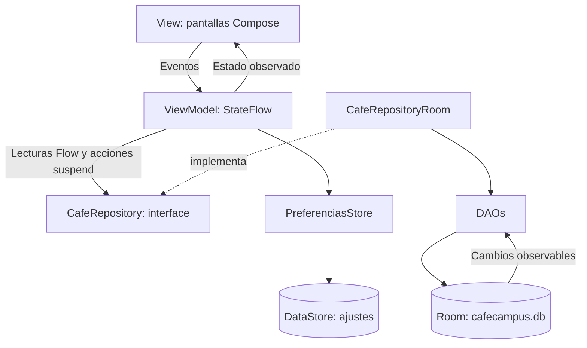

# CafeCampus


## Descripción

Aplicación de práctica para pedidos de la cafetería del campus. El estudiante consulta productos, arma su carrito, confirma y sigue sus pedidos. El administrador atiende pedidos, gestiona productos y cambia las preferencias. Ambos perfiles comparten una única base Room local.

Implementación de la Fase 1 (pasos 1 al 12), Kotlin, Jetpack Compose, Material 3, Room, DataStore y Navigation Compose. Incluye las pantallas de la Fase 1 y los ajustes posteriores solicitados durante la práctica: búsqueda funcional y login obligatorio. El buscador filtra nombre, descripción y categoría, combinándose con la categoría seleccionada e ignorando mayúsculas y tildes. El gráfico «Pedidos por hora» usa datos fijos de ejemplo; las ventas y los contadores del panel consultan Room.

La implementación utiliza Room **2.7.2** (runtime, ktx y compiler), actualizado desde 2.6.1 para resolver el error de KSP observado con la configuración del proyecto. Se conservaron las versiones de AGP, Kotlin y KSP.

## Cuentas ficticias

| Perfil | Correo | Clave |
| --- | --- | --- |
| Estudiante | juan@campus.test | 1234 |
| Administrador | admin@cafe.test | admin |

Los datos se siembran una sola vez, en una transacción, cuando no hay usuarios. El inicio de sesión espera que termine esa inicialización. Al abrir una nueva ejecución se solicita correo, contraseña y perfil. «Cambiar de perfil» cierra la sesión actual, selecciona el otro perfil en el login y vuelve a solicitar credenciales. El tema oscuro y la recepción de pedidos siguen persistiendo en DataStore. La rotación conserva la sesión del ViewModel; no se exige iniciar sesión otra vez por rotar.

Estas dos decisiones —pedir credenciales al reabrir/cambiar de perfil y habilitar la búsqueda— son ajustes solicitados durante la práctica y difieren del flujo inicial del PDF. El interruptor Notificaciones guarda una preferencia local; no implementa avisos del sistema Android.

## Estructura de paquetes

```text
com.tecsup.cafecampus
├── data
│   ├── local
│   │   ├── dao
│   │   │   ├── PedidoDao.kt
│   │   │   ├── ProductoDao.kt
│   │   │   └── UsuarioDao.kt
│   │   ├── entity
│   │   │   ├── DetallePedido.kt
│   │   │   ├── Pedido.kt
│   │   │   ├── Producto.kt
│   │   │   └── Usuario.kt
│   │   ├── relation
│   │   │   └── PedidoConDetalle.kt
│   │   ├── CafeDatabase.kt
│   │   └── DatosIniciales.kt
│   ├── prefs
│   │   └── PreferenciasStore.kt
│   └── repository
│       ├── CafeRepository.kt
│       └── CafeRepositoryRoom.kt
├── model
│   ├── EstadoPedido.kt
│   ├── ItemCarrito.kt
│   └── Rol.kt
├── ui
│   ├── admin
│   │   ├── AjustesScreen.kt
│   │   ├── ComponentesAdmin.kt
│   │   ├── DetallePedidoAdminScreen.kt
│   │   ├── FormularioProductoScreen.kt
│   │   ├── MenuAdminScreen.kt
│   │   ├── PanelScreen.kt
│   │   └── PedidosAdminScreen.kt
│   ├── cliente
│   │   ├── ComponentesEstudiante.kt
│   │   ├── ConfirmarPedidoScreen.kt
│   │   ├── DetalleProductoScreen.kt
│   │   ├── LoginScreen.kt
│   │   ├── MenuScreen.kt
│   │   ├── MisPedidosScreen.kt
│   │   ├── SeguimientoScreen.kt
│   │   └── SplashScreen.kt
│   ├── components
│   │   ├── AppTopBar.kt
│   │   ├── CafeButton.kt
│   │   ├── CafeTextField.kt
│   │   ├── EstadoChip.kt
│   │   ├── PedidoCard.kt
│   │   ├── ProductoCard.kt
│   │   ├── ProductoIcono.kt
│   │   └── StepperEstado.kt
│   ├── navigation
│   │   ├── NavCafe.kt
│   │   └── Rutas.kt
│   └── theme
│       ├── CafeTheme.kt
│       ├── Color.kt
│       ├── IlustracionTheme.kt
│       ├── Theme.kt
│       └── Type.kt
├── viewmodel
│   ├── CafeViewModelFactory.kt
│   ├── MenuAdminViewModel.kt
│   ├── MenuViewModel.kt
│   ├── PanelAdminViewModel.kt
│   ├── PedidosAdminViewModel.kt
│   ├── PedidosClienteViewModel.kt
│   └── SesionViewModel.kt
├── CafeApp.kt
└── MainActivity.kt
```

## Arquitectura MVVM



Las pantallas reciben ViewModels. La creación de dependencias se resuelve en CafeApp/CafeViewModelFactory y se conecta en NavCafe. Los ViewModels de negocio dependen de CafeRepository; sesión y confirmación también consultan PreferenciasStore, como exige el contrato de DataStore del laboratorio.

Lecturas reactivas: Flow transformado a StateFlow con stateIn. Escrituras: suspend y viewModelScope. PedidoDao.crearPedido usa @Transaction; los detalles guardan una foto del nombre y precio, sin clave foránea al producto. Las transiciones viven en EstadoPedido y PedidosAdminViewModel. El carrito se mantiene en el ViewModel durante una rotación; no se persiste ante la muerte del proceso.

El tema CafeTheme aplica el perfil y el modo oscuro; los colores fijos están centralizados en el tema, incluidos los colores semánticos de estado. Las pantallas consumen MaterialTheme.colorScheme y los colores semánticos provistos por el tema. El tema de plantilla original se conserva para GreetingPreview.

## Capturas de la aplicación

Las seis capturas reales todavía están pendientes. No se sustituyen por los mockups del laboratorio. Guarda los PNG en `docs/capturas/` usando los nombres de esta tabla; la guía explica cómo obtenerlas e insertarlas.

| Perfil | Pantalla | Archivo previsto | Estado |
| --- | --- | --- | --- |
| Estudiante | Menú | `docs/capturas/01-cliente-menu.png` | Pendiente |
| Estudiante | Confirmar pedido | `docs/capturas/02-cliente-confirmar.png` | Pendiente |
| Estudiante | Seguimiento | `docs/capturas/03-cliente-seguimiento.png` | Pendiente |
| Administrador | Panel | `docs/capturas/04-admin-panel.png` | Pendiente |
| Administrador | Pedidos | `docs/capturas/05-admin-pedidos.png` | Pendiente |
| Administrador | Gestión del menú | `docs/capturas/06-admin-menu.png` | Pendiente |

[Guía de capturas](docs/capturas/README.md) · [Guía de pruebas de aceptación](docs/PRUEBAS_ACEPTACION.md)

## Paso 12: pruebas de aceptación

La revisión del asistente no ejecutó Gradle ni compiló el proyecto. El usuario ya abrió versiones de la aplicación en Android Studio, pero no se dispone de evidencia suficiente para marcar las nueve pruebas como aprobadas. En el último intento de revisión visual, el emulador mostraba la pantalla de arranque de Android; no se obtuvieron capturas de las pantallas ni se completaron pruebas. Una revisión del código no equivale a una prueba aprobada.

La guía enlazada indica pasos, resultados esperados y evidencias para completar cada prueba sin borrar los datos del dispositivo.

| Prueba | Resultado esperado | Estado |
| --- | --- | --- |
| Login con clave incorrecta | Mensaje de error; no permite entrar. | Pendiente en emulador |
| Estudiante agrega 2 productos y confirma | Pedido RECIBIDO, total correcto y carrito vacío. | Pendiente en emulador |
| Producto agotado | No permite agregarlo ni confirmar un carrito que lo contiene. | Pendiente en emulador |
| Administrador pasa un pedido a Preparando | Seguimiento cambia por Flow sin reiniciar. | Pendiente en emulador |
| Administrador cancela un pedido | Aparece CANCELADO en el historial del estudiante. | Pendiente en emulador |
| Administrador cambia el precio de un producto | Los pedidos anteriores conservan nombre y precio unitario. | Pendiente en emulador |
| Ventas del día | Suma pedidos del día no cancelados. | Pendiente en emulador |
| Cerrar y abrir la aplicación | Persisten pedidos y modo oscuro; se vuelve a solicitar login, según el ajuste pedido por el usuario. | Pendiente en emulador |
| Rotar la pantalla | Conserva carrito, sesión y datos de pantalla. | Pendiente en emulador |

Comprobaciones adicionales: selector de rol y error de rol incorrecto; CRUD de productos y confirmación de eliminación; cerrar cafetería y bloquear confirmación; persistencia de modo oscuro; cambio de perfil y limpieza de pila. Pendientes de ejecución.

## Revisión realizada

Se revisaron paquetes, imports internos, contratos de interface/implementación, parámetros, delimitadores, rutas y límites entre capas en los 55 archivos Kotlin. Las 13 consultas SQL se validaron con SQLite sobre un esquema equivalente; la suma vacía devuelve 0.0. No se ejecutaron KSP, Room ni el compilador Kotlin. El aspecto final en dispositivo, las llamadas a APIs de Compose y la integración de navegación requieren la compilación y ejecución del proyecto en Android Studio.

Se conservaron los modelos originales, Producto y ProductoDao. La única actualización de dependencias realizada fue Room a 2.7.2. Los cambios se organizaron en commits locales de los pasos del laboratorio y un commit adicional de compatibilidad. La revisión de Git consultó `origin/main` sin hacer push. No se generaron APK ni archivos zip desde el asistente.

## Ejecutar y validar

1. Abrir `Semana08/CafeCampus` en Android Studio y sincronizar con la configuración existente.
2. Elegir el emulador y ejecutar con Run. La compilación y ejecución se realizan desde Android Studio.
3. Ingresar con la cuenta ficticia del perfil correspondiente.
4. Completar [las nueve pruebas](docs/PRUEBAS_ACEPTACION.md), registrar el resultado observado y tomar las seis capturas.
5. Añadir las imágenes al README siguiendo [la guía](docs/capturas/README.md). Solo entonces cambiar los estados pendientes por resultados comprobados.

## Estado de la entrega

El código y la documentación de arquitectura están registrados. Las capturas y la aceptación completa siguen pendientes de comprobar en el emulador. No se presenta esta práctica como una entrega completamente verificada mientras esas evidencias falten.

## Para pensar

1. Repository es una interface para que el ViewModel use un contrato y pueda cambiar la fuente de datos sin cambiar la pantalla.
2. crearPedido es suspend porque realiza una acción; observarPedidosCliente es Flow porque avisa cada vez que cambian los pedidos.
3. Con bases distintas, el administrador y el estudiante verían pedidos diferentes y el seguimiento no reflejaría los cambios.
4. Con un servidor, se implementaría el mismo contrato con una fuente remota y se resolverían red, autenticación y errores en la capa de datos.
