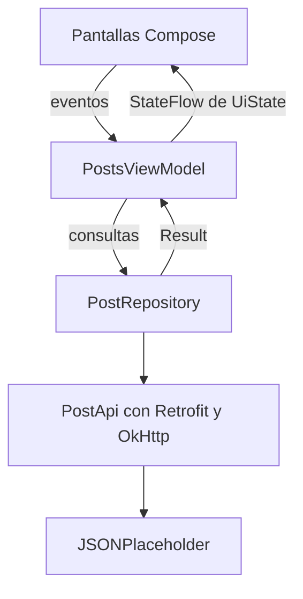
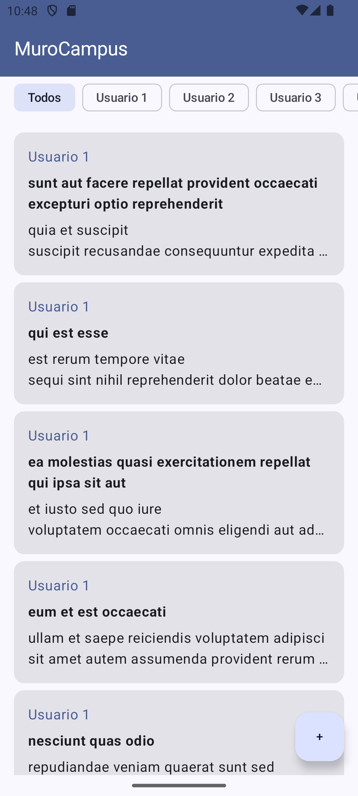
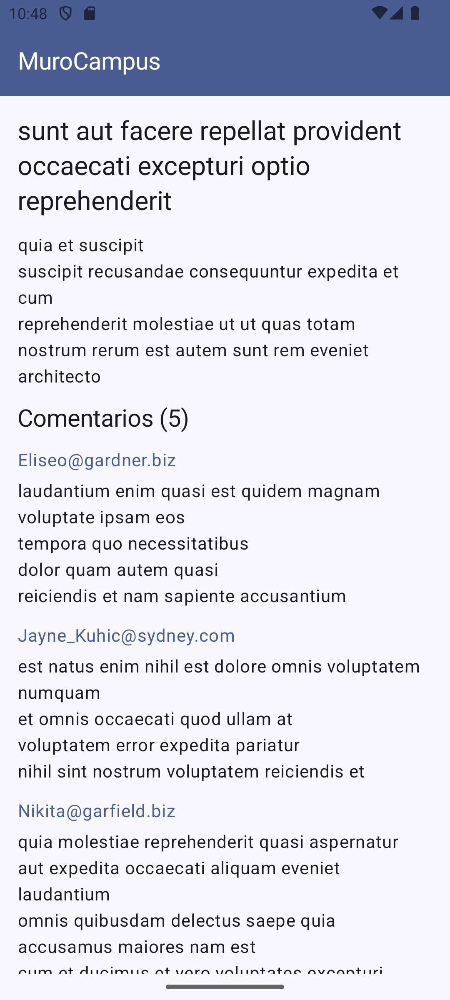
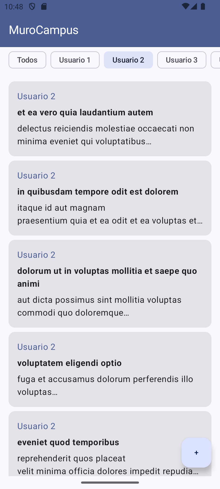
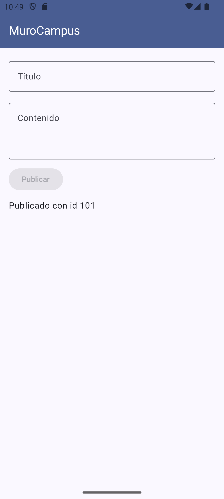
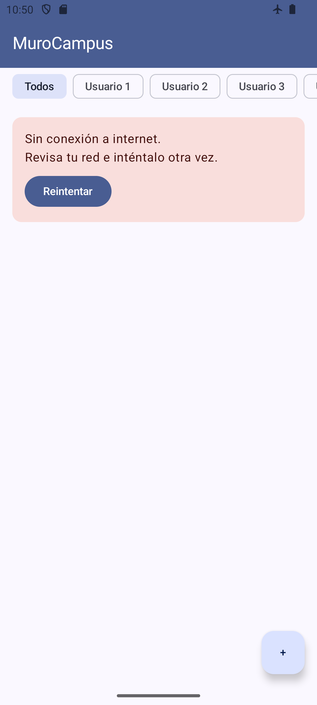

# MuroCampus

App Android en Kotlin y Jetpack Compose que consulta publicaciones y comentarios de JSONPlaceholder. Permite filtrar por usuario, enviar una publicación de prueba y reintentar una consulta cuando falla.

## Ejecutar

Abre la carpeta MuroCampus en Android Studio, sincroniza Gradle y ejecuta la app en un emulador o teléfono con internet.

## Estructura de paquetes

```text
com.meneses.murocampus/
├── MainActivity.kt
├── model/
│   └── Modelos.kt
├── data/
│   ├── PostRepository.kt
│   └── remote/
│       ├── PostApi.kt
│       └── RetrofitClient.kt
├── viewmodel/
│   ├── PostsViewModel.kt
│   ├── PostsViewModelFactory.kt
│   └── UiState.kt
└── ui/
    ├── Componentes.kt
    ├── PantallaLista.kt
    ├── PantallaDetalle.kt
    ├── PantallaCrear.kt
    └── theme/
```

## Arquitectura MVVM



## Capturas

| Lista | Detalle | Filtro | Crear | Error de conexión |
| --- | --- | --- | --- | --- |
|  |  |  |  |  |

## Para pensar

1. **GET y POST.** GET consulta recursos y POST envía datos para crear uno. `@Body` serializa la publicación nueva en el cuerpo de la petición. `@Query` agrega el parámetro `userId` a la URL para filtrar.
2. **Ruta relativa.** `posts` se resuelve a partir de la URL base de Retrofit. `/posts` empieza en la raíz del servidor y descartaría cualquier prefijo de ruta de esa URL.
3. **Result.** El repositorio convierte los fallos de la consulta en valores que el ViewModel puede transformar en estados. La cancelación de corrutinas se propaga.
4. **Permiso y JSON.** Sin el permiso `INTERNET`, Android impide la conexión. Sin `ignoreUnknownKeys`, un campo nuevo en el JSON puede provocar un error de deserialización.
5. **UiState.** Un `when` exhaustivo representa un solo estado activo por pantalla. Tres variables independientes podrían indicar a la vez que hay progreso, contenido y error.
6. **Servicio real.** Con persistencia real, después de un POST exitoso se podría volver a consultar la lista o incorporar la publicación devuelta por el servidor respetando el filtro. JSONPlaceholder simula la creación y devuelve el ID 101.
