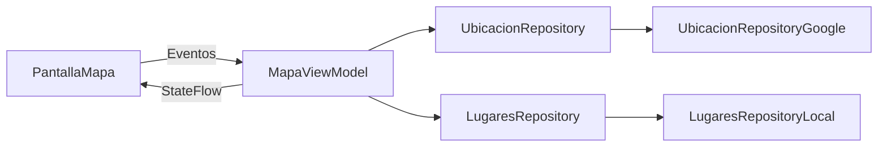

# CampusGPS

Aplicación Android en Kotlin, Jetpack Compose y Material 3. Muestra la posición del usuario y cinco lugares ficticios de un campus de Lima, ordenados por distancia en línea recta.

## Configuración

1. Abre `Semana13/CampusGPS` en Android Studio.
2. Habilita Maps SDK for Android en Google Cloud. Si te pide facturación, consulta con el docente.
3. Obtén la huella SHA-1 con `gradlew.bat signingReport` y restringe tu clave al SDK, al paquete `com.meneses.campusgps` y a esa huella.
4. Agrega `MAPS_API_KEY=tu_clave` a `local.properties`. Git ignora ese archivo.
5. Ejecuta con un emulador con Google Play. En **Extended controls → Location**, configura latitud `-12.0464` y longitud `-77.0428`. Pulsa **Set location**.

## Paquetes

```text
com.meneses.campusgps
├── MainActivity.kt
├── model/
│   └── Modelos.kt
├── data/
│   ├── UbicacionRepository.kt
│   ├── UbicacionRepositoryGoogle.kt
│   ├── LugaresRepository.kt
│   └── LugaresRepositoryLocal.kt
├── util/
│   ├── Distancia.kt
│   └── Formato.kt
├── viewmodel/
│   ├── MapaViewModel.kt
│   └── CampusViewModelFactory.kt
└── ui/
    ├── PantallaMapa.kt
    ├── MapaUbicacion.kt
    ├── ListaLugares.kt
    ├── MensajeError.kt
    └── theme/
```



## Pruebas de aceptación

- [ ] En la primera búsqueda, Android muestra el cuadro de permiso.
- [ ] Al aceptar, se muestran latitud, longitud y el marcador rojo.
- [ ] Al negar, aparece **Abrir ajustes** y la app sigue abierta.
- [ ] En el punto base se ven cinco marcadores del campus. Tras buscar, el más cercano queda verde.
- [ ] Al tocar un marcador se muestran el nombre y la categoría.
- [ ] La lista queda ordenada por distancia y muestra m o km.
- [ ] Al tocar una tarjeta se resalta y la cámara se desplaza.
- [ ] **Ir al más cercano** está deshabilitado al inicio y lleva al marcador verde tras la búsqueda.
- [ ] Cambiar la ubicación y buscar actualiza distancias, orden y color.
- [ ] Con la ubicación apagada, aparece **Reintentar**.
- [ ] Al rotar la pantalla se conservan las coordenadas y la lista.
- [ ] La clave y `local.properties` están fuera del repositorio.

## Capturas requeridas

Pendientes de tomar en el emulador con Maps configurado.

1. Cuadro de permiso.
2. Mapa con el marcador **Estás aquí**.
3. Marcadores de los cinco lugares.
4. Lista ordenada por distancia.
5. Mensaje de error con su acción.

## Para pensar

1. **¿Por qué el cliente de ubicación está en el repositorio?** Porque allí se integra la API de Android. El ViewModel consume una interfaz y puede probarse con otra implementación sin depender de Google Play Services.
2. **¿Qué diferencia hay entre permiso y clave?** El permiso permite leer la posición del dispositivo. La clave autoriza al SDK a cargar el mapa. Si se niega el permiso, no se obtiene la posición. Si falta una clave válida, el mapa base no se carga.
3. **¿Por qué la clave está en `local.properties`?** Para que quede fuera del historial de Git. Si se publica por error, se revoca o elimina en Google Cloud y se crea otra con restricciones de aplicación y API.
4. **¿Dónde se calcula la distancia?** El ViewModel llama a una función de `util` al recibir una posición y publica la lista ordenada. Compose muestra los resultados incluso si se vuelve a dibujar la pantalla.
5. **¿Qué pasa si se niega dos veces?** Android puede dejar de abrir el cuadro de permiso. CampusGPS muestra **Abrir ajustes** para que el usuario pueda conceder el permiso desde la configuración.
