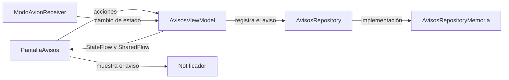

# AvisosCampus

Aplicación Android de notificaciones locales hecha con Kotlin, Jetpack Compose y Material 3. Genera avisos desde un botón, un recordatorio de diez segundos y los cambios de modo avión. Muestra los 20 avisos más recientes de la sesión.

## Estructura

```text
com.meneses.avisoscampus/
├── AvisosApp.kt
├── MainActivity.kt
├── data/
│   └── AvisosRepository.kt
├── model/
│   └── Modelos.kt
├── notificacion/
│   └── Notificador.kt
├── receiver/
│   └── ModoAvionReceiver.kt
├── ui/
│   ├── HistorialAvisos.kt
│   ├── PantallaAvisos.kt
│   └── theme/
└── viewmodel/
    ├── AvisosViewModel.kt
    └── AvisosViewModelFactory.kt
```

## Diagrama MVVM



## Pruebas de aceptación

Usa Android 13 o superior para probar el permiso de notificaciones.

- [ ] El canal Avisos aparece en los ajustes de notificaciones de la app.
- [ ] El diálogo de permiso actualiza la etiqueta al aceptar o denegar.
- [ ] Mostrar aviso genera Tarea lista. Dos pulsaciones generan dos notificaciones.
- [ ] Tocar una notificación abre la app y la quita del panel.
- [ ] El recordatorio cuenta diez segundos, llega con la app minimizada y puede cancelarse.
- [ ] La cuenta regresiva continúa al rotar la pantalla.
- [ ] Con el interruptor activo, el modo avión registra Activado y Desactivado. Con el interruptor apagado, no genera avisos.
- [ ] El historial muestra primero el aviso más reciente y se conserva al rotar.
- [ ] Si se deniega el permiso, se guarda el aviso y Abrir ajustes lleva a las opciones de la app.

## Capturas

Pendientes de obtener en el emulador: notificación en el panel, cuenta regresiva, modo avión, historial y permiso denegado.

## Para pensar

1. **¿Por qué hacen falta un canal y un permiso?** El canal agrupa las notificaciones y permite que el usuario configure cómo se presentan. Si el canal requerido no existe, Android no muestra la notificación. Desde Android 13, el permiso permite que la app publique notificaciones. Si se deniega, el sistema no las muestra.
2. **¿Por qué el ViewModel emite un evento?** El ViewModel decide qué aviso se genera y lo registra. La pantalla recibe el evento y llama al Notificador con el contexto de Android, lo que mantiene la lógica del ViewModel separada del sistema.
3. **¿Qué pasa con dos notificaciones con el mismo ID?** La segunda actualiza o reemplaza a la primera. Con IDs distintos, ambas pueden verse.
4. **¿Por qué `onReceive` debe ser corto y por qué quitar el receptor?** Android espera que el receptor devuelva el control pronto. Al desregistrarlo cuando ya no se necesita, se dejan de recibir eventos y se evita retener referencias a la pantalla.
5. **¿Cuándo usar una notificación local o una push de Firebase?** Una local sirve para sucesos que la app conoce en el dispositivo, como el recordatorio. Una push sirve para sucesos que conoce un servidor, como la publicación de una nota o un anuncio nuevo.
